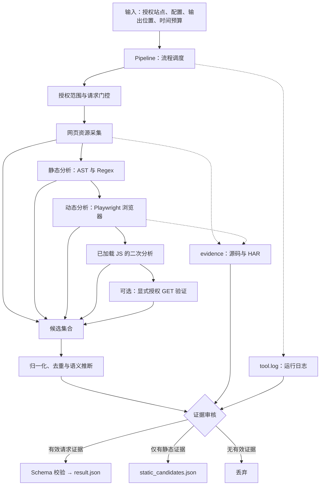

# 🎉 API Extractor — 完结撒花！🌸

**TOPIC B｜前端 API 提取工具｜v0.1.0｜工程开发阶段收官**

在明确授权的 Web 站点中，从网页源码寻找接口线索，观察浏览器真实网络请求，再核对证据并生成结构化接口清单。

**项目已经形成可运行、可测试、可复现的工程闭环，但不保证任意网站的全部接口覆盖，也不代表官方隐藏评测或系统级安全审计已经通过。**

## 1. 文档阅读导航

本项目按照**读者需求**组织文档，而不是按照开发过程堆积文档。

| 阅读路线 | 适合谁 | 内容与入口 |
|---|---|---|
| 01 · 通俗化 | 零基础读者 | [项目介绍、术语解释、通俗架构与文件职责](docs/01-overview/README.md) |
| 02 · 专业化 | 开发者、研究者、技术答辩者 | [专业篇总导航](docs/02-technical/README.md) |
| 02.1 · 架构 | 希望理解模块如何协作 | [详细架构设计](docs/02-technical/01-ARCHITECTURE.md) |
| 02.2 · 算法 | 希望理解算法原理与评价模型 | [算法与数学推导](docs/02-technical/02-ALGORITHMS.md) |
| 02.3 · 版本 | 希望了解项目如何演进 | [版本升级简史](docs/02-technical/03-VERSION_HISTORY.md) |
| 03 · 操作化 | 希望安装、运行、测试或维护 | [运行命令与故障排查](docs/03-operations/README.md) |

推荐先阅读通俗篇，再根据需要进入专业篇或操作篇。了解文档目录的完整结构及功能，请查看 [docs 文档中心](docs/README.md)。

## 2. 项目工作原理与架构图

### 2.1 从一个生活例子理解项目

在购物网站搜索商品时，浏览器可能向服务器请求商品信息。显示网页的是**前端**，处理数据的是**后端**，两者之间交流的约定称为 API（应用程序接口）。

本项目像一位负责核对门牌的调查员：先阅读建筑图纸（网页源码），再观察哪些门实际打开过（浏览器网络请求），最后把真实观察和待验证线索分开整理。

### 2.2 整体架构



图中实线表示主要处理与数据关系，虚线表示证据或日志记录。实际阶段由主流程协调，并非全部并发运行。

| 关键概念 | 它解决的问题 |
|---|---|
| 静态分析 | 不必实际触发每条请求，从 HTML 和 JavaScript 寻找可能的接口声明。 |
| AST（抽象语法树） | 将代码解析为树形结构，帮助识别函数调用及参数。 |
| Regex（正则表达式） | 按文字模式补充或回退查找接口线索。 |
| 动态分析 | 通过 Playwright 控制 Chromium 浏览器，观察页面实际发出的请求。 |
| 归一化与去重 | 将不同资源编号对应的同类路径整理为统一模板，合并重复记录。 |
| Scope 与限流 | 限定授权主机、控制同时处理的请求数量与发送速率。 |
| HAR 与日志 | HAR 是网络请求记录格式，日志记录运行过程；两者用于核对本轮真实请求。 |
| JSON Schema | 规定输出 JSON 的字段及类型，确保报告格式合法。 |

### 2.3 最终交付

| 文件 | 用途 |
|---|---|
| `result.json` | 经本轮请求证据审核的正式接口及协议传输记录。 |
| `static_candidates.json` | 有源码线索、尚无有效请求证据的候选清单。 |
| `tool.log` | JSONL 运行日志，即每行一个 JSON 对象，包括阶段与最终运行状态。 |
| `evidence/` | 保存 HAR、网页和 JavaScript 等证据材料。 |

**核心原则：源码声明不等于真实请求；有真实请求也不等于该接口可成功重放、业务含义完全正确或已经找全全站接口。**

更细的控制流、模块依赖、算法公式与设计取舍见第一章的专业篇。

## 3. 已有功能与发展方向

### 3.1 目前能做到什么程度？

| 能力 | 当前支持程度 | 不能保证 |
|---|---|---|
| 网页与源码采集 | 有界采集 HTML、CSS、JS、表单、链接，使用 AST/Regex 寻找接口声明 | 无限深度遍历、任意混淆代码的完整理解 |
| 浏览器动态发现 | 观察 Fetch/XHR 等实际网络请求，提供 HAR 与日志证据 | 自动触发所有隐藏业务分支 |
| SPA 与懒加载 | 支持部分单页应用内部路由，二次分析已经下载的 JS 代码块 | 找到尚未加载的全部代码和页面 |
| 基础登录 | 尝试常见账号密码表单；已验证合成 Cookie 登录和受控后续导航 | 任意 SSO（单点登录）、MFA（多因素认证）、验证码或复杂多阶段认证 |
| 现代通信协议 | 识别部分 GraphQL 查询、WebSocket 双向连接、SSE 单向事件流及 Socket.IO 轮询/握手 | 完整恢复所有协议定义、订阅事件及业务语义 |
| 参数与认证 | 归纳路径、查询和请求体参数，推断常见鉴权类别与部分签名字段 | 完整恢复任意加密签名算法或服务端契约 |
| 证据与安全 | 请求证据分流、Schema 校验、授权主机检查、重定向约束、限流、部分脱敏 | 独立防伪、绝对无副作用、完整系统级隔离 |
| 工程交付 | Python CLI、Docker 镜像、自动测试及可追溯的实测记录 | 所有环境都能顺利部署或官方评测满分 |

适合用于**自建或明确获授权的站点**，辅助建立已观测 API 清单、学习网络通信及开展开发回归。不是认证绕过器、漏洞利用工具或任意网站的全量接口地图。

### 3.2 资源限制与后续方向

当前默认运行预算 1200 秒，请求门控 8 并发、20 次/秒；静态采集最多保留 12 个页面、80 份脚本记录；运行时 JS 缓存最多 32 份、单份 2 MiB、合计 8 MiB。这些是源码层面的约束，不是实际网络吞吐或整个进程硬时限的保证。

| 后续可研究方向 | 当前为何尚不能宣称完成 |
|---|---|
| 陌生站点覆盖率 | 需要独立真实接口清单，才能测量召回率与精确率。 |
| 复杂登录与交互 | 站点权限、用户流程和认证方式差异较大。 |
| 更深的协议与字段语义 | 当前主要依赖实际观察和启发式规则，而非完整业务模型。 |
| 系统级安全审计 | 正式文件访问、代理及 DNS 约束仍需在等价环境验证。 |

这些是后续维护方向，并非已实现的功能或新的开发承诺。

## 4. 项目文件结构

```text
API/
├── README.md                 项目总说明、阅读导航、长期文档规范
├── api_extractor/            Python 核心程序
│   ├── cli.py                命令行入口
│   ├── pipeline.py           流程编排、预算、状态
│   ├── config.py             配置读取
│   ├── scope.py              授权范围判断
│   ├── request_control.py    并发与速率门控
│   ├── crawler.py            网页和前端资源采集
│   ├── static_analysis.py    静态源码分析
│   ├── dynamic_analysis.py   浏览器动态观察
│   ├── candidates.py         候选记录适配
│   ├── normalization.py      归一化与合并
│   ├── evidence.py           证据审核
│   ├── output.py             结果生成与校验
│   └── result.schema.json    输出格式规则
├── tools/                    JavaScript AST 辅助解析程序
├── scripts/                  安装、启动、诊断及验收脚本
├── tests/                    自动测试和合成站点
├── examples/                 配置与输出样例
├── docs/
│   ├── README.md             文档总导航
│   ├── 01-overview/          通俗化介绍
│   │   └── README.md
│   ├── 02-technical/         专业化介绍
│   │   ├── README.md
│   │   ├── 01-ARCHITECTURE.md
│   │   ├── 02-ALGORITHMS.md
│   │   └── 03-VERSION_HISTORY.md
│   └── 03-operations/        操作化命令手册
│       └── README.md
├── .github/workflows/        GitHub Actions 自动检查流程
├── Dockerfile                容器镜像构建说明
├── requirements.txt          Python 依赖清单
├── pyproject.toml            Python 项目与测试配置
├── package.json              Node.js 依赖声明
├── package-lock.json         Node.js 依赖版本锁定
├── site.json                 示例配置
├── TOPIC                     选题标识
├── api_task.md               项目任务说明
├── demo/                     演示材料说明
└── archive/                  历史交付物，非当前核心源码
```

这是重点目录图，并非逐个列出所有源码文件。专项协议、认证、重定向、离线评分等模块的完整职责见 [专业架构设计](docs/02-technical/01-ARCHITECTURE.md)。

项目沿用根目录下的 `api_extractor/` Python 包布局，不另建一套重复的 `src/` 代码。

## 5. 运行与维护入口

**所有现行可执行命令统一维护在 [03 运行操作篇](docs/03-operations/README.md)，首页不再重复安装、启动或测试命令。**

| 操作需求 | 应查看的内容 | 成功判据 |
|---|---|---|
| 首次安装 | 环境检查、依赖、初始化 | 必要环境可用，依赖安装成功 |
| 本地运行 | 授权目标与配置、启动参数 | 输出格式合法，并核对日志的运行状态 |
| Docker 运行 | 镜像构建、容器网络、挂载、生命周期 | 容器可访问授权服务，扫描结果和日志可核查 |
| 自动验收 | 单元测试、隔离合成站双轮测试 | 所有相关断言通过，而非仅退出码为 0 |
| 离线评分 | 独立真值、两轮输出、评分参数 | 得到真实可核查的局部指标，不冒充官方总分 |
| 维护排障 | 环境诊断、日志、运行状态 | 根据诊断确认故障原因，必要时重测 |

推荐先检查环境，再运行隔离合成测试，最后在明确授权的目标上操作。不要将真实账号、Token、Cookie、HAR 或内部源码提交到公开仓库。不要未经许可修改系统服务或清理其他容器。

主要技术依赖：Python 3.11+、HTTPX、BeautifulSoup、Playwright/Chromium、jsonschema、Node.js/Babel、pytest 和 Docker。安装前置条件与版本以实际依赖文件、操作篇和当前源码为准。

## 6. 实际验收状态

### 6.1 可复核的工程验收

| 验收项目 | 已确认结果 |
|---|---|
| 主分支集成 | PR #1 与 PR #2 已合入 main |
| Python 全仓库测试 | 267 项通过 |
| Docker / Chromium 合成测试 | 10/10 通过：SPA、SPA Hash、SSR、SSE、模拟登录各两轮 |
| 越界合成接收端 | 未收到被禁止的请求 |
| Docker 构建 | 2026-11-24 已完成的 CI 记录：30 秒、2,864,324,068 字节 |
| 自建 Juice Shop 实测 | 独立两轮均完整结束，每轮 9 条有 HAR 证据的接口/传输记录 |
| 双轮集合一致性 | Juice Shop Jaccard = 1.0000 |
| Socket.IO | 两轮各 3 条传输记录均已分类，不等同于三个业务 REST API |

对应证据：[主分支 CI（2026-11-24）](https://github.com/David-tiao/API/actions/runs/45326156648) · [独立 Juice Shop 双轮验收](https://github.com/David-tiao/API/actions/runs/45133273791) · [全部 GitHub Actions](https://github.com/David-tiao/API/actions) · [清理前的固定历史文档快照](https://github.com/David-tiao/API/tree/64e20a0f0d985ce78f29647e220ae88cec6122cb/docs)。

这些是已经完成的历史运行记录，不自动代表任意未来提交已通过。自建 Juice Shop 在隔离 Docker 网络中运行，没有对公共演示站进行扫描。

### 6.2 正确理解测试结论

- Jaccard 为 1 表示两轮端点集合相同，**不是召回率或精确率 100%**。
- 267 项测试通过，只证明被覆盖的测试场景符合预期。
- `run_status:completed` 表示本轮流程完成，不表示已找齐全部 API；合法的部分结果也可能以退出码 0 结束。
- 官方 S1–S5 隐藏评测、完整 R7/R8 系统级审计、未知站点召回与精确率均尚未取得正式结论。

**AI 辅助声明：** 开发过程中使用 OpenAI ChatGPT 辅助架构讨论、代码草拟、测试、排错与文档编写。提交者应理解、审查并能够独立解释和维护项目，按实际情况如实完善正式提交材料。

## 7. 长期复用的文档编写规范

本章是后续开发与文档维护的共同约定。核心思想：**按照读者需求组织文档，而不是按照开发过程堆积文件。**

### 7.1 文档分层化

| 文档层级 | 必须做到 | 不应出现 |
|---|---|---|
| 通俗化（01-overview） | 对必要专业名词作通俗解释，结合生活实例介绍原理，用直观方式讲架构、文件职责和能力边界 | 运行命令、过多底层实现或无解释的术语堆积 |
| 专业化（02-technical） | 详细架构设计、数据流与模块关系；从基本原理推导算法公式并对应源码；精简记录每次版本升级 | 将未实现的理论模型说成代码功能，或把历史测试当作当前结果 |
| 操作化（03-operations） | 集中维护安装、运行、测试、维护、排障命令；注明执行位置、环境、前置条件、预期输出和成功判据 | 仅给出命令而不说明适用条件，或在其他篇章重复维护命令 |

### 7.2 精简化不等于简单化

真正需要精简的是**重复内容与不必要的复杂性**，而不是帮助读者理解知识的必要解释。

| 不合适的写法 | 应采用的写法 |
|---|---|
| 删除专业名词 | 保留必要名词，首次出现时说明含义 |
| 直接罗列技术 | 说明每种技术解决什么问题、为什么使用 |
| 只给数学公式 | 定义变量、列出假设、逐步推导、给出例子，并对应实际源码 |
| 大量文字描述架构 | 选择合适的架构图或数据流图辅助说明 |
| 每轮升级新增大量文档 | 在统一版本简史中增加一行核心变化、原因与证据 |
| 多份文档重复介绍相同功能 | 合并内容，建立权威位置并通过索引关联 |
| 只提供运行命令 | 注明执行位置、环境、前提、结果和成功判据 |

### 7.3 图形化表达

不同知识应选择合适的表达方式，而不是为装饰而添加图形。

| 内容 | 推荐表达方式 |
|---|---|
| 项目组成 | 目录树 |
| 系统模块关系 | 架构图 |
| 数据传递过程 | 数据流图 |
| 网络通信过程 | 时序图 |
| 算法执行过程 | 流程图 |
| 任务状态变化 | 状态机图 |
| 数学算法原理 | 公式与逐步推导 |
| 版本迭代 | 精简表格 |

图中应明确数据从哪里来、经过什么处理、保存在哪里、最终产生什么结果。图示必须和实际模块、调用顺序及实现边界相符；示意模型应明确标注，不冒充现有功能。

### 7.4 先整体，再局部

介绍顺序采用：

**项目目标 → 整体原理 → 系统架构 → 模块职责 → 算法及数学模型 → 具体操作与验证。**

先让读者理解为什么需要这个项目，再解释系统怎样工作，最后深入代码和公式。专业篇公式需要有变量定义、假设、推导、适用范围与源码位置；理想复杂度和实际实现复杂度应明确区分。通俗篇适当取舍技术细节，但保留理解整体所需的关键概念。

### 7.5 每次开发后的文档更新流程

1. 确定本次新增功能、解决的问题、影响范围及实现边界。
2. 更新通俗介绍和新增专业名词，保留必要的易懂解释。
3. 更新专业架构、算法原理、源码对应关系及必要数学推导。
4. 更新操作篇的命令、执行环境、前置条件、预期输出和成功判据。
5. 在统一版本简史中增加一行核心升级内容、原因与实际验收证据。
6. 必要时同步修改架构图、数据流图、状态图和文件结构。
7. 删除重复或过时内容，检查内部链接、源码引用与真实验收状态。

不因每次版本升级就创建一大批独立文档。旧记录通过 Git 历史和固定提交链接追溯；当前文档以真实源码与可核查证据为准。

**交付检查：** 初学者能看懂，研究者能推导，操作者能执行，维护者能追溯。每轮文档修改还应确认没有虚构功能、测试成绩或删除必要的历史证据。

---

🌸 **完结撒花！** 当前工程开发与已有验收形成闭环，未来维护请沿用以上文档标准。
