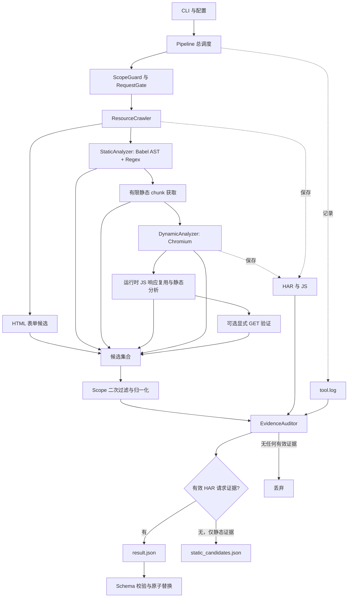

# 02.1｜专业架构设计：模块、数据流与边界

> 对应已合并的 v0.1.0 收官基线。以下是对实际源码结构的说明，而不是拟议的新功能。运行方法集中在 [操作篇](../03-operations/README.md)，数学模型集中在 [算法篇](02-ALGORITHMS.md)。

## 1. 设计目标与约束

项目针对选题 B 的前端 API 提取任务：在授权站点上，从网页资源和浏览器网络行为中发现接口，输出结构化、可复核的报告。设计优化目标是**在有限时间内平衡覆盖率、误报、请求证据质量和安全边界**。没有可靠真值时，不把发现条数等同于召回率。

工程选择 Python 作为主控，HTTPX 和 BeautifulSoup 负责资源采集，Node.js/Babel 负责 JavaScript 语法解析，Playwright/Chromium 负责运行时观察，jsonschema 负责输出验证。运行期不依赖外部 AI 服务。

## 2. 系统上下文与输入输出

| 输入 | 契约 |
|---|---|
| target | 明确授权的 HTTP(S) 起始 URL |
| config | JSON 配置：site_id、allowed_hosts、可选凭据和请求头等 |
| out | 输出路径；评测容器中约束至 /out |
| budget | 秒级时间预算，默认 1200 |

| 输出 | 含义 |
|---|---|
| result.json | 通过本轮请求证据审核的端点/传输记录 |
| static_candidates.json | 经源码证据审核但无有效 HAR 请求证明的候选 |
| tool.log | JSONL 请求记录、诊断与运行状态 |
| evidence/ | HAR、HTML、JS 等支持材料；可能含敏感信息 |

控制面（参数、授权、预算、调度）和数据面（网页、源码、请求、候选、证据）通过 Python 模块接口协作。它是一次性批处理 CLI，不是长驻 API 服务，也没有数据库或分布式集群。

## 3. 总体架构

图是逻辑关系，不表示所有阶段并发。实际由 `pipeline.run_pipeline` 顺序协调：先初始爬取与静态分析，再运行浏览器，分析浏览器已下载的新脚本，最后可选显式 GET 验证与结果汇总。离线评分器独立于生产流程。

## 4. 模块分层与职责

| 层 | 源码 | 主要输入 → 输出 |
|---|---|---|
| 入口 | [cli.py](../../api_extractor/cli.py) | CLI 参数 → pipeline 调用与退出码 |
| 编排 | [pipeline.py](../../api_extractor/pipeline.py) | 配置与预算 → 各阶段调度、候选汇总、状态、结果 |
| 配置 | [config.py](../../api_extractor/config.py) | JSON → SiteConfig；校验字段形状 |
| 安全控制 | [scope.py](../../api_extractor/scope.py)、[request_control.py](../../api_extractor/request_control.py) | URL 判定、共享并发/速率门控 |
| 资源采集 | [crawler.py](../../api_extractor/crawler.py) | 起始地址 → CrawlResult：页面、脚本、链接、表单 |
| 静态分析 | [static_analysis.py](../../api_extractor/static_analysis.py)、[js_ast_analyzer.cjs](../../tools/js_ast_analyzer.cjs) | ScriptRecord → 候选和 chunk URL |
| 动态分析 | [dynamic_analysis.py](../../api_extractor/dynamic_analysis.py) | 浏览器页面 → 请求记录、运行时脚本、HAR |
| 专项网络策略 | [redirect_policy.py](../../api_extractor/redirect_policy.py)、[sse_sampling.py](../../api_extractor/sse_sampling.py) | 下一跳判定、有界 SSE 采样 |
| 候选适配 | [candidates.py](../../api_extractor/candidates.py) | 表单与网络观察 → 统一候选；不自行联网 |
| 可选验证 | [verification.py](../../api_extractor/verification.py) | 明确允许且已有静态声明的精确 GET → 请求证据 |
| 归一化 | [normalization.py](../../api_extractor/normalization.py) | 候选 → 按方法/主机/路径合并的端点 |
| 专项语义 | [graphql_semantics.py](../../api_extractor/graphql_semantics.py)、[signature_semantics.py](../../api_extractor/signature_semantics.py)、[transport_semantics.py](../../api_extractor/transport_semantics.py) | 协议分类、观察字段与有限语义注记 |
| 证据与日志 | [evidence.py](../../api_extractor/evidence.py)、[jsonl_logger.py](../../api_extractor/jsonl_logger.py) | 证据引用 → 本轮一致性核验；日志脱敏 |
| 交付 | [output.py](../../api_extractor/output.py)、[result.schema.json](../../api_extractor/result.schema.json) | 已审核数据 → Schema 合规的 JSON |
| 独立评估 | [offline_benchmark.py](../../api_extractor/offline_benchmark.py) | 人工真值、两轮输出 → 离线局部指标；不扫描 |

模块边界的意义是：采集代码不直接决定最终输出，候选适配不发网络请求，语义分类不代替证据审核，评分器不参与生产扫描。这些分层有利于单独测试和定位错误。

## 5. 核心数据流与设计细节

### 5.1 静态采集与解析

ResourceCrawler 使用有界 FIFO 队列与已访问集合，保存 HTML、内联/外部脚本和表单结构。默认最多保留 12 个页面、80 个脚本记录；这是采集成果的上限，不是所有尝试请求的总数。HTTP 跳转逐次检查授权范围。每次响应保留的正文片段上限为 8 MiB，不能据此推断网络下载峰值也严格限制在该值。

StaticAnalyzer 调用固定的本地 Node 脚本解析 JavaScript，而不是执行目标站点脚本作为系统命令。AST 和 Regex 的发现合并；AST 子进程单次超时 12 秒，解析失败时回退正则。只保留满足 URL 范围与启发式规则的候选。主流程对去重后的第一批静态 chunk 地址最多尝试 40 个，并受爬虫脚本上限约束；当前并非递归解析所有嵌套 chunk 的完整依赖图。

### 5.2 浏览器动态分析与登录

Playwright 访问授权页面并捕获 Fetch、XHR、EventSource、WebSocket 等资源类型。支持尽力识别常见用户名/密码登录表单；凭据来自配置，不猜测密码。先收集登录后链接，再结合初始页和爬虫发现页探索。每页最多采集 24 个合格链接，候选导航地址最多 48 个，主探索循环最多 12 次（不含先前登录导航）；包含安全 Hash 路由的识别。页面会有一次有界滚动和请求稳定等待，不遍历未知按钮或任意业务表单。

实际加载的 JS 响应可复用为 ScriptRecord，最多 32 个、单个 2 MiB、合计 8 MiB，不为此额外重放资源请求。源码分析只能产生静态证据。

### 5.3 认证、重定向与流式请求

ScopeGuard 结合本地 libpsl 的可注册域与允许主机规则；缺少公共后缀库时保守回退，不推断兄弟域授权。HTTP 重定向逐跳判断，避免自动跳往未授权主机。常见同源登录 POST 的 301/302/303 后续 GET 可以按决策表处理；307/308 不盲目重放未知非幂等方法。部分 origin 或方法变化时过滤显式请求头。

SSE 使用独立有界采样，最多 32 KiB / 5 秒，提取第一个完整真实数据事件；不模拟无限持续流、不转发站点认证凭据。WebSocket 连接占用共享门控槽位直到关闭。Socket.IO 根据观察到的协议特征标注轮询与握手，不把不透明 POST 帧当表单解析。

以上是代码级控制和有限测试证据，不保证任意站点 GET 无副作用，也不构成完整的 OS 级隔离证明。

### 5.4 候选与端点模型

来源包括 AST、Regex、HTML 表单、动态网络和显式验证 GET。统一候选携带方法、URL、来源、启发式置信度、部分参数及证据索引。动态候选适配只接受相应网络资源类型，并过滤已知的 GET/fetch 静态翻译字典。

归一化以 (method, host, normalized_path) 为合并键；对数字、UUID、长十六进制片段做模板化。GraphQL 可标为 GQL，WebSocket 可标为 WS，并在证据核对时映射到底层 HTTP 方法。字段类型、required、auth 和业务 note 是有限观察和规则推断，不是服务端契约的完整证明。

### 5.5 证据审核与交付

EvidenceAuditor 限制引用文件在输出根目录中，检查 HAR 索引、方法、主机、规范化路径、响应状态，以及脱敏后的完整 URL 是否与本次运行日志对应；源码片段证据另行验证。HAR 只表示观察记录，不保证可重放或业务操作成功。401/403 等也可能作为请求存在的证据。

有效 HAR 决定正式结果分流；只有静态证据的端点进入 sidecar，无有效证据的丢弃。输出使用 JSON Schema 校验后以临时文件替换目标，避免普通写入中途留下截断的正式 JSON（不承诺断电持久性）。侧文件写入失败会记录诊断。

## 6. 运行状态与故障隔离

| 状态 | 语义 |
|---|---|
| completed | 主流程结束，不代表全站覆盖 |
| incomplete_budget | 预算取消，尝试保留已获得的可审核结果 |
| partial_browser_failure | 浏览器阶段失败但仍可交付合法部分结果 |
| failed | 致命流程或输出校验失败 |

预算内的阶段等待使用 asyncio.wait_for；清理、审核和输出还需时间，因此不能把参数当作整个进程绝对硬时限。运行状态与退出码需要结合解读；合法部分交付可能退出 0。正式 Docker 或评测环境仍需外部强制超时与系统级资源审计。

## 7. 部署与验证架构

Dockerfile 提供 Python/Node/Chromium 运行依赖，评测运行以只读配置和可写输出挂载为边界。`.github/workflows/quality-gate.yml` 先执行离线回归再构建镜像并运行隔离的合成站点。独立 Juice Shop 工作流使用固定镜像摘要、自建内网和双轮验证；其历史分支触发规则不等于每次 main CI 都重跑 Juice Shop。

当前已测证据：[主分支 CI](https://github.com/David-tiao/API/actions/runs/45140723425)（267 项、10 次合成 Chromium），[独立 Juice Shop](https://github.com/David-tiao/API/actions/runs/45133273791)（每轮 9 条记录、3 条 Socket.IO 传输）。这些覆盖特定场景，未证明官方 S1–S5 分数、全量 R7/R8 安全审计或任意站点的完整发现率。

延伸阅读：[数学与算法推导](02-ALGORITHMS.md) · [版本简史](03-VERSION_HISTORY.md) · [历史架构决策](../adr/0001-compatibility-first.md) · [能力边界](../CAPABILITIES_AND_LIMITS.md)。
