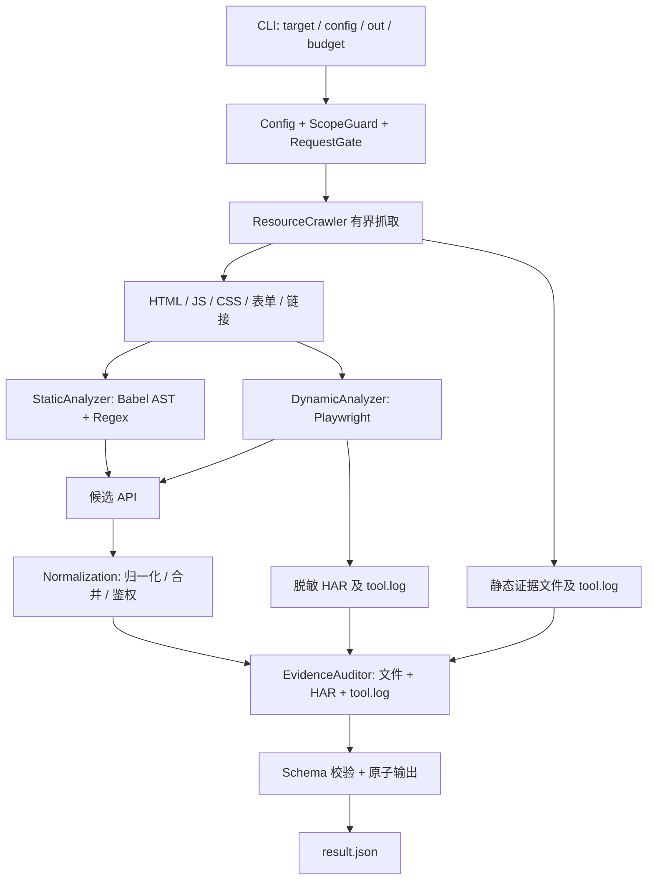

# API Extractor：项目迭代、架构、数据流与底层算法

> 仓库：[David-tiao/API](https://github.com/David-tiao/API) · 选题 B（前端 API 自动提取）  
> 依据：仓库实际源码、`api_task.md`、`RECRUIT-2026-考核细则.md` 和 Git 提交历史。  
> 验证原则：**代码审查/模拟测试通过，不代表真实 Docker 或 S1～S5 隐藏评测通过。**

## 1. 项目的本质

项目输入一个已获授权的 Web 站点，在不预知目标业务逻辑的前提下，采集 HTML 和 JS，结合静态分析与浏览器动态请求观察，合并成有来源的 API 清单。

**核心设计：**静态分析扩大覆盖范围，动态观察提供运行时证据，归一化减少重复，独立证据审计阻止无效引用进入最终结果。

## 2. 真实迭代记录

| 版本节点 | Git 提交 | 为什么修改、有什么收获 |
|---|---|---|
| 项目原型 | `946c488` | 建立 Python + Node AST + Playwright + Docker 的基本流水线；模块齐全不代表验证充分 |
| WebSocket 修复 | `ec1e6c0` | 修复 Playwright 1.55 WebSocket route 调用方式并等待运行时请求稳定；不能靠猜测版本 API |
| 安全与运行契约 | `130ca62` | 错误返回码、域名默认边界、日志路径、失败请求过滤及 Docker 锁文件修复；避免假成功和越界 |
| S4 与验收工具 | `980b434` | Body 中签名字段推断、排除 `design` 误报，本地 HTTP 集成测试及双轮验收脚本 |
| R7 文件系统约束 | `33a7a0f` | 将浏览器 HOME、TMPDIR 与缓存指向 `/out`；配置引导不等于已完成文件系统审计 |
| S5 静态入口 | `043d2b2` | 识别字面量 WebSocket 和 EventSource，补充 AST/Regex 结果合并与越界测试 |
| 证据链审计 | `ba07d6e` | 新增 `evidence.py`，查验源文件、HAR 请求索引、方法、主机、路径及动态日志，拒绝无效证据 |

问题明细与工程经验持续维护在 [FIXES_AND_LESSONS.md](FIXES_AND_LESSONS.md)。这些提交均为开发记录，不构成评分保证。

更细的逐提交变更文件、原因和验收状态，请参阅 [CHANGELOG.md](CHANGELOG.md)。

## 3. 总体架构与数据流

### 主要文件职责

| 模块 | 实际职责 |
|---|---|
| `api_extractor/cli.py` | 解析四个固定参数并返回程序退出码 |
| `pipeline.py` | 主流程、超时预算、阶段协调、异常处理 |
| `config.py`、`scope.py` | 读取站点配置、执行访问范围限制 |
| `request_control.py` | 爬虫与浏览器共用并发/速率限制 |
| `crawler.py` | 获取 HTML、外部/内联 JS、CSS、链接和表单，并保存静态证据 |
| `static_analysis.py`、`tools/js_ast_analyzer.cjs` | AST 和正则寻找 API 请求调用、动态 import |
| `dynamic_analysis.py` | Chromium 网络监听、SSE/WS 识别、脱敏 HAR |
| `normalization.py` | 路径参数化、候选去重、参数/鉴权/响应结构推断 |
| `evidence.py` | 校验每条引用是否对应实际存在且一致的证据 |
| `jsonl_logger.py` | JSONL 请求日志和敏感 URL 参数脱敏 |
| `output.py`、`result.schema.json` | JSON Schema Draft 2020-12 校验及原子输出 |

### 一次任务如何流转

1. **输入**：`--target`、`--config`、`--out`、`--budget`。
2. **预检查**：验证容器挂载路径、读取 `site.json`、创建访问白名单和全局限流器。
3. **采集**：先抓 HTML、JS、表单与有限同站链接，保存下载的源码和页面。
4. **静态分析**：Node/Babel AST 提取候选接口，正则兜底，追踪有限数量动态 import。
5. **动态分析**：Playwright 打开网页、滚动、尝试常见登录，监听 Fetch/XHR/EventSource/WebSocket。
6. **合并**：按照 `(method, host, normalized_path)` 合并，推断参数、鉴权及响应字段。
7. **审计**：排除不存在、路径越界、HAR 索引错误或缺少运行时日志的无效证据。
8. **输出**：Schema 校验通过后写入 `result.json`；请求和诊断写入 `tool.log`。

## 4. 底层算法说明

### 4.1 有界网站资源探索：BFS 队列 + 哈希去重

`ResourceCrawler` 从目标 URL 开始，按照 HTML 中发现的同站链接扩展抓取队列。使用 `_seen_pages`、`_seen_assets` 排除已访问页面和 JS。默认最多 12 页、80 个脚本；单个响应体截取前 8 MiB，HTTP 重定向逐跳检查域名范围。证据文件名由 URL 与内容 SHA-256 摘要导出，避免同名文件互相覆盖。

**取舍**：有界探索避免预算耗尽或无穷爬取，却不能保证发现所有 JavaScript 路由。

### 4.2 JS 静态分析：AST + 保守的 Regex

Node `@babel/parser` 将前端 JS 解析为语法树，识别 `fetch`、`axios.get/post` 等方法、`.request` 封装、XHR `.open` 及 `import()`。对于可恢复的字符串、模板字面量、简单字符串拼接生成路径；无法静态恢复的变量片段可使用 `{id}` 占位。Python 正则在 AST 不适用时兜底，也补充 `new WebSocket(...)` 和 `new EventSource(...)` 字面量地址。

**取舍**：AST 利于理解 method、url、params 和 data 的语法关系；Regex 易产生误报，必须做路径/方法启发式过滤。复杂混淆、运行时 baseURL 和任意签名算法不在当前静态分析的可靠覆盖范围内。

### 4.3 动态分析：Playwright 路由拦截 + 事件驱动

浏览器只放行 `ScopeGuard` 允许的请求；利用网络 request/response/finished/failed 事件采集 URL、Method、状态码、响应 Content-Type 和 JSON 字段。WebSocket 保存握手证据及少量帧方向、类型元数据；不保存消息体中的令牌与敏感数据。HAR 记录索引并脱敏敏感查询值。

**取舍**：运行时观察能够补充静态候选，但只访问有限页面、执行基础滚动与常见账号密码表单登录；没有实现任意业务点击、SSO/MFA、可验证签名复算或完整 WS 订阅语义。

### 4.4 全局请求限制：信号量 + 单调时钟

`RequestGate` 用 `asyncio.Semaphore(8)` 控制最多八个并发槽；通过互斥锁维护上次发起请求的单调时间，按 `1/20 = 0.05 秒` 的间隔调度。静态 HTTP 与动态浏览器共用限流器。

**重要**：这说明代码中有限流逻辑，**并不能替代代理侧实际测出的 RPS/并发验证**，尤其对长连接和浏览器异步请求仍需单独测量。

### 4.5 端点归一化：路径等价类 + 字段集合合并

把纯数字、UUID 和长十六进制路径段改写为 `{id}`，已有 `:name` / `{name}` 也转成统一形式。候选按 `(Method, Host, 标准化路径)` 聚合，多来源的参数和证据被合并。请求值用于推断 `string/integer/boolean/number/object/array` 等类型；它是观察到的类型，不等于服务端正式参数 Schema。

### 4.6 鉴权及业务语义：规则推断而非模型猜测

从 Header、Query 和 JSON/form Body 识别 Cookie、Bearer、API Key、签名字段（例如 `signature` / `sign`）。普通 `design` 字段不会因为包含单词 `sign` 就误判为加密签名。简短业务说明来自路径词语，不能把这种启发式描述表述为已核实的业务语义。

### 4.7 新增证据审计：零信任引用与日志交叉核查

**以前：**结果中只要有 `evidence` 数组，Schema 就可能通过，哪怕文件不存在或 HAR 指错请求。

**现在：**每条 evidence 在输出前必须重新审核：

- 源文件须在输出目录内，拒绝绝对路径、`..` 穿越、越界符号链接、空文件和缺失文件。
- JS/HTML 的代码片段须能在对应源文件中找到；这证明源码声明，**不等于 API 可调用**。
- HAR `request_index` 必须有效，请求 Host、归一化 Path、HTTP Method 必须和候选一致。
- `WS` 的实际网络方法映射为 WebSocket 握手 GET；`GQL` 允许底层 GET/POST。
- 动态证据还必须在 `tool.log` 中存在同方法/主机/路径且具有有效状态的 `dynamic` 请求记录。
- 错误证据被移除；若一条 API 全部证据均失效，则该 API 不输出。统计数量记入 `verify` 阶段日志。

实现上使用 `set` 索引动态日志、缓存单次 HAR 解析，限制单个 HAR 读取量。该规则提高证据一致性，但**仍不等于真实重放/业务验证**。对于只在 JS 中静态可见的候选，还需要后续补充强请求证据。

### 4.8 交付：Schema 校验 + 原子替换

`output.py` 使用 Draft 2020-12 检查结果格式；先写临时文件，再用 `Path.replace()` 将其替换为目标输出，避免部分写入。明显异常时主流程返回非零退出码，日志保留故障记录。

## 5. 为什么说前几轮修复有依据

| 问题 | 代码上的修复依据 | 仍不能保证什么 |
|---|---|---|
| 错误退出码假成功 | `pipeline.py` 异常分支设置 `exit_code=1`；测试模拟采集模块抛错 | 不等于所有第三方异常均已覆盖 |
| 默认兄弟域越界 | `ScopeGuard` 默认仅允许目标主机及其后代，白名单仍受同注册域约束 | 手工注册域后缀表不等于完整 Public Suffix List |
| 失败请求误报 | 动态 candidate 携带状态，归一化过滤未完成与多数错误状态 | 静态候选还可能是未调用的死代码 |
| 登录 Header 未传递 | 浏览器上下文设置 `extra_http_headers` | 真实站点登录成功率未测 |
| 构建缺锁文件 | Dockerfile 最终镜像复制 `package-lock.json` | 实际联网构建仍可能失败 |
| 证据引用造假风险 | 新增 EvidenceAuditor + 测试验证文件归属、索引、请求一致性 | 尚未证明真实目标的证据都可重放 |

## 5.1 V8 的可靠性增强：任务状态与部分结果

新增浏览器 `failure_reason` 和管线 `run_status` 状态，区分完整完成、浏览器部分失败、预算截断与严重失败。流程即使因预算被取消，也尝试把已完成的动态观察与静态证据一起审计并输出。**考核 R2 要求合法交付的退出码为 0，因此部分结果可以退出 0，但日志必须明确标记并非完整成功。**

技术理由和离线验收记录见 [CHANGELOG.md](CHANGELOG.md) 的 V8，以及 [FIXES_AND_LESSONS.md](FIXES_AND_LESSONS.md) 的第 11 节。

## 5.2 V9 的审计关联与日志安全改进

`JsonlLogger` 现在会记下追加式 `tool.log` 在本轮开始前的字节偏移 `start_offset`；主流程把它传给 `EvidenceAuditor`，因此证据审核只消费本轮动态请求行。HAR 和日志按 **(Method, Host, 标准化 Path, request_index, status)** 联合匹配，防止上一轮同路径请求或错误索引被误用。静态 JS/HTML 的文件/片段审计与动态 HAR 独立，不因缺少运行时请求而丢弃真正的静态发现。

URL 日志在写入前统一去掉 userinfo 并隐藏敏感 Query 值。短键（如 `key`、`jwt`、`code`）采用完整字段名/分词判断，避免 `design` 等普通名称被粗暴覆盖。管线异常日志只记录类型以减少泄露风险。这一策略改善最常见的路径，但不替代对所有证据文件和第三方输出的完整保密审计。

详见 [CHANGELOG.md](CHANGELOG.md) 的 V9、[FIXES_AND_LESSONS.md](FIXES_AND_LESSONS.md) 的第 12 节。此次离线测试属于 **30 项针对性测试**，不得与此前 35 项测试相加来推断当前全仓库测试数。

## 5.3 V10 候选适配层与结构治理

在保持 `api_extractor/` 原包目录的前提下，将原来 `pipeline.py` 内的 HTML 表单与浏览器网络候选转换规则抽为独立 `candidates.py`：`from_html_forms()`、`from_network_records()`。两个函数只产生规范候选字典，保留动态请求 `status` 与 `request_index`，不自行访问网络、修改浏览器或写文件。后续仍由 `normalization.py` 统一去重推断，再由 `evidence.py` 校验证据。

V10 结构变更包括 `archive/legacy/` 历史归档与 `docs/README.md` 导航；保持 `scripts/`、Dockerfile 与 CLI 不动。详见 [PROJECT_STRUCTURE.md](PROJECT_STRUCTURE.md)、[ADR-0001](adr/0001-compatibility-first.md)。本轮新模块 8 项离线单元测试通过；不能据此断言完整 Docker 通过。

## 5.4 V11：Public Suffix 作用域判定与 WebSocket 在途资源模型

**域名判定**：从 URL 解析 hostname，执行 IDNA 规范化，使用 `libpsl.psl_registrable_domain` 查询操作系统内建 Public Suffix List。仅当请求 Host 与入口 Host 属于同一可注册域，且命中站点配置的 `allowed_hosts`（如有）时允许访问。IP 地址只按原 IP 匹配；URL 包含 username/password 则拒绝。PSL 不可用时返回完整 Host，而不是以不完整规则猜测公共后缀，因而“默认拒绝”未被破坏。PSL 数据来自镜像内系统库，**运行期不联网更新**。

**WebSocket 门控**：Playwright 的 `route_web_socket` 接入既有 `RequestGate`。进入连接时获取信号量并接受最小间隔限速；`connect_to_server()` 同步建立上游路由，借 `on_close` 回调在关闭时释放。开放 WS 持续占用槽位，计入 R4 的同时在途预算；错误路径由 `try/except BaseException` 回收槽位。即使客户端或上游重复触发关闭回调，`BrowserRequestLimiter.after` 通过 active 集合防止重复释放。

**限制**：仅在单事件循环内保障代码门控，代理与浏览器真正发出的握手、服务端长连接和运行时 DNS 行为仍需外部网络审计。PSL 库在正式 Docker 中是否存在还需真实构建验证。详见 [V11 验收状态](ACCEPTANCE_V11_2026-11-22.md)。

## 5.5 V12：证据强度分级与结果分流

以前：`normalize_candidates → EvidenceAuditor → result.json`，静态证据和动态已观察请求使用同一种最终输出通道。

现在：`normalize_candidates → EvidenceAuditor → split_by_request_proof → {result.json, static_candidates.json}`。证据审计先验证引用在文件系统内、HAR 索引与当前任务日志一致；分级器是**纯函数**，只看审核后的 `evidence` 是否包含 `type=har`。

- **强证据（已观察）**：与本轮工具日志、HAR 互相核对，进入正式 `result.json`；可同时保留 HTML/JS 源码作为补充证据。
- **弱证据（仅静态）**：只有 JS/HTML 声明，进入 `static_candidates.json` 用于人工复核、后续安全验证及调试，不参与正式评分输出。
- **安全**：不自动发起新的请求，静态清单不复制敏感 JS 片段或认证 Header；保持 CLI 与组织方固定 Schema。
- **代价**：当浏览器未触发 T1 静态接口时，会降低 Recall；另缺少真正的重放执行确认。这一设计优先使当前提交的可信程度与它宣称的证据等级一致。

见 [V12 版本更迭](CHANGELOG.md) 和 [V12 验收快照](ACCEPTANCE_V12_2026-11-22.md)。

## 6. 当前验证等级与未解决问题

本轮不扫描真实网站、不运行 Docker/Chromium。隔离 Python 工作副本的离线测试和本地模拟 HTTP 夹具 **共 35 项通过**，Python `compileall` 及 Bash 语法检查通过。测试新增了证据文件缺失、路径穿越、越界 symlink、HAR 错索引、错 Method、日志缺失及 WS/GQL 映射等场景。

**明确未验证**：Docker 实际构建与镜像大小/耗时、Chromium 真正运行、S1～S5 的 Recall/Precision、双轮评测稳定性、真实代理的 R4/R8、系统级 R7 文件审计。这些不能据静态代码推断为 PASS。

后续优先事项：① 正式交付与网络/磁盘边界；② 强化静态候选的真实请求证明；③ S3 登录成功判定与 JS 路由探索；④ S4 签名追踪/复算；⑤ S5 WS 订阅、SSE 事件和 GraphQL variables；⑥ 基于 ground truth 的 Recall、Precision 和证据重放评分。

## 7. AI 协作记录

本次由 AI 辅助阅读需求和源码、设计并实现证据审计、编写回归测试及本架构文档。没有修改其他仓库，也没有执行真实靶站扫描。开发者应独立审查、理解和维护提交内容，在正式交付时保留真实提交历史并如实声明 AI 使用范围。
