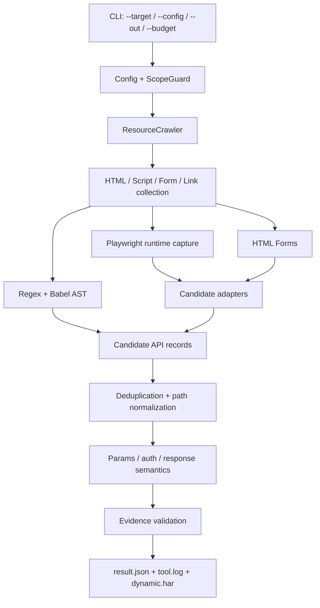

# Architecture

## Modules

- `config.py`: reads the organization-provided `site.json`.
- `scope.py`: enforces the target registrable domain and `allowed_hosts` allowlist.
- `request_control.py`: shared concurrency (maximum 8) and rate (maximum 20 requests/second) gate.
- `crawler.py`: collects HTML, script bundles, stylesheets, forms and internal links.
- `static_analysis.py` + `tools/js_ast_analyzer.cjs`: Babel AST and conservative regex fallback.
- `dynamic_analysis.py`: Playwright Fetch/XHR/EventSource/WebSocket capture and sanitized HAR evidence.
- `candidates.py`: pure HTML form / browser network observation conversion.
- `evidence.py`: source and HAR/request-log consistency validation.
- `normalization.py`: method/path deduplication, dynamic path normalization, parameter and auth inference.
- `output.py`: validates and atomically writes the fixed result schema.

## Data flow

The tool first performs bounded HTTP collection, then analyzes fetched JavaScript and follows a bounded number of statically referenced lazy chunks. It next visits the collected in-scope pages with a headless browser. Static and runtime candidates are merged by `(method, host, normalized_path)`. Every emitted endpoint has at least one evidence record. Sensitive query values and credentials are redacted from logs/HAR evidence.

## Security boundary

Only HTTP(S)/WS(S) URLs in the target's registrable domain and configured `allowed_hosts` are eligible. Out-of-scope browser requests are aborted. HTTP redirects are revalidated before following. The runtime does not call external model services, does not execute shell commands extracted from pages, and does not write outside the designated output directory in the evaluation container.

## V11 安全边界补充

- `scope.py` 改用系统 libpsl 的公共后缀列表确定目标可注册域；无库时保守限制到当前目标主机及其后代。
- `dynamic_analysis.py` 的 WebSocket route 现在持有共享请求门控槽位至连接关闭，不再绕过 HTTP 的并发/RPS 控制。
- 这些为代码级与离线模拟层面的改进；代理和真实浏览器层面的 R4/R5 仍需实测。静态候选真实请求/重放证据仍待 R6 专项完善。
